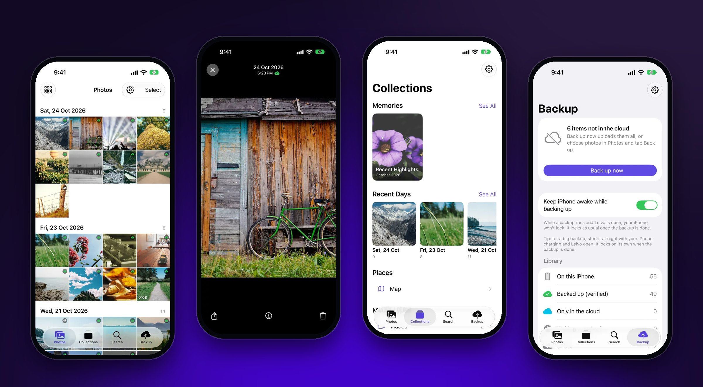

<h1 align="center">
   
  Lelvo
</h1>

  Your photos, backed up to your own Telegram.

  <a href="https://lelvo.app"><strong>Website</strong></a> ·
  <a href="docs/FEATURES.md"><strong>Features</strong></a> ·
  <a href="docs/INSTALL.md"><strong>Install</strong></a> ·
  <a href="docs/FAQ.md"><strong>FAQ</strong></a> ·
  <a href="docs/CHANGELOG.md"><strong>Changelog</strong></a> ·
  <a href="https://t.me/lelvo_chat"><strong>Community</strong></a>

  <a href="https://github.com/shahil-kv/Lelvo/releases/latest"><picture><source media="(prefers-color-scheme: dark)" srcset="https://shieldcn.dev/github/release/shahil-kv/Lelvo.svg?variant=ghost&amp;font=geist-mono&amp;mode=dark&amp;label=RELEASE&amp;logo=lu:Tag&amp;valueColor=A78BFA" /></picture></a>
  <a href="https://github.com/shahil-kv/Lelvo/releases"><picture><source media="(prefers-color-scheme: dark)" srcset="https://shieldcn.dev/github/downloads/shahil-kv/Lelvo.svg?variant=ghost&amp;font=geist-mono&amp;mode=dark&amp;label=DOWNLOADS&amp;logo=lu:CloudDownload&amp;valueColor=60A5FA" /></picture></a>
  <a href="https://github.com/shahil-kv/Lelvo/actions/workflows/ci.yml"><picture><source media="(prefers-color-scheme: dark)" srcset="https://shieldcn.dev/github/ci/shahil-kv/Lelvo.svg?variant=ghost&amp;font=geist-mono&amp;mode=dark&amp;workflow=ci.yml&amp;label=CI&amp;logo=lu:Hammer&amp;valueColor=4ADE80" /></picture></a>
  <a href="https://t.me/lelvo_chat"><picture><source media="(prefers-color-scheme: dark)" srcset="https://shieldcn.dev/badge/TELEGRAM-JOIN.svg?variant=ghost&amp;font=geist-mono&amp;mode=dark&amp;logo=telegram&amp;valueColor=38BDF8" /></picture></a>

  <a href="https://lelvo.app/support"><picture><source media="(prefers-color-scheme: dark)" srcset="https://shieldcn.dev/badge/SUPPORT-CARD%20%2F%20UPI.svg?variant=ghost&amp;font=geist-mono&amp;mode=dark&amp;logo=lu:Heart&amp;logoColor=A78BFA&amp;valueColor=A78BFA" /></picture></a>
  <a href="LICENSE"><picture><source media="(prefers-color-scheme: dark)" srcset="https://shieldcn.dev/badge/LICENSE-GPL--3.0.svg?variant=ghost&amp;font=geist-mono&amp;mode=dark&amp;logo=lu:Scale" /></picture></a>

Lelvo backs up every photo and video, in original quality and end-to-end encrypted, to a private channel in your own
Telegram account. Phone and cloud photos sit together in one fast timeline on iPhone, Mac and Android. There are no
Lelvo servers, no account, no ads and no tracking, and the code is open source under GPL-3.0.

Telegram can't read your photos, and neither can we. Restore a whole library by signing in on a new phone, free up
space safely, and leave any time: the [storage format](docs/CLOUD_FORMAT.md) is public.

[Explore all features →](docs/FEATURES.md)

> [!NOTE]
> Lelvo uses the Telegram API. It is an independent app, not made, endorsed or supported by Telegram.

## Install

| | |
|---|---|
| **Mac** | [Download Lelvo.dmg](https://github.com/shahil-kv/Lelvo/releases/latest/download/Lelvo.dmg) · macOS 15 or later |
| **Android** | `.apk` from the [latest release](https://github.com/shahil-kv/Lelvo/releases/latest) · Android 10 or later |
| **iPhone** beta | [TestFlight](https://testflight.apple.com/join/N9uhRuEy) or [sideload the IPA](docs/INSTALL.md#sideloading-on-iphone) · iOS 17 or later |

Setup steps, and what to know [before you trust it with your only copy](docs/INSTALL.md#before-you-trust-it-with-your-only-copy),
are in the [install guide](docs/INSTALL.md).

## Contributing

Bug reports, ideas, translations and code are welcome. Please read the [contributing guide](CONTRIBUTING.md) first:
code changes start from an `approved` issue. To build it yourself, see [building from source](docs/INSTALL.md#building-from-source).
Report security problems privately through [SECURITY.md](SECURITY.md).

## License

Licensed under the [GPL-3.0 license](LICENSE). The Lelvo name and icon are covered by [TRADEMARKS.md](TRADEMARKS.md), and third-party licenses are in [NOTICE.md](NOTICE.md).
