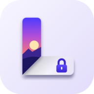
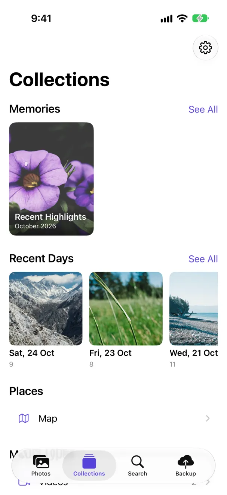

<h1 align="center">
  <a href="https://lelvo.app"></a><br>
  Lelvo
</h1>

<p align="center">
  <strong>Your photos, backed up to your own Telegram.</strong><br>
  Every photo and video, in original quality and end-to-end encrypted, in a private channel you own.<br>
  One fast timeline on iPhone, Mac and Android.
</p>

<p align="center">
  <a href="https://lelvo.app"><strong>Website</strong></a> ·
  <a href="#download"><strong>Download</strong></a> ·
  <a href="#features"><strong>Features</strong></a> ·
  <a href="docs/FAQ.md"><strong>FAQ</strong></a> ·
  <a href="docs/CHANGELOG.md"><strong>Changelog</strong></a> ·
  <a href="https://t.me/lelvo_chat"><strong>Telegram group</strong></a> ·
  <a href="https://lelvo.app/support"><strong>Support</strong></a>
</p>

<p align="center">
  <a href="https://github.com/shahil-kv/Lelvo/releases/latest"><picture><source media="(prefers-color-scheme: dark)" srcset="https://shieldcn.dev/github/release/shahil-kv/Lelvo.svg?variant=ghost&amp;font=geist-mono&amp;mode=dark&amp;label=RELEASE&amp;logo=lu:Tag&amp;valueColor=A78BFA" /></picture></a>
  <a href="https://github.com/shahil-kv/Lelvo/releases"><picture><source media="(prefers-color-scheme: dark)" srcset="https://shieldcn.dev/github/downloads/shahil-kv/Lelvo.svg?variant=ghost&amp;font=geist-mono&amp;mode=dark&amp;label=DOWNLOADS&amp;logo=lu:CloudDownload&amp;valueColor=60A5FA" /></picture></a>
  <a href="https://github.com/shahil-kv/Lelvo/actions/workflows/ci.yml"><picture><source media="(prefers-color-scheme: dark)" srcset="https://shieldcn.dev/github/ci/shahil-kv/Lelvo.svg?variant=ghost&amp;font=geist-mono&amp;mode=dark&amp;workflow=ci.yml&amp;label=CI&amp;logo=lu:Hammer&amp;valueColor=4ADE80" /></picture></a>
  <a href="LICENSE"><picture><source media="(prefers-color-scheme: dark)" srcset="https://shieldcn.dev/badge/LICENSE-GPL--3.0.svg?variant=ghost&amp;font=geist-mono&amp;mode=dark&amp;logo=lu:Scale" /></picture></a>
  <a href="https://t.me/lelvo_chat"><picture><source media="(prefers-color-scheme: dark)" srcset="https://shieldcn.dev/badge/TELEGRAM-JOIN.svg?variant=ghost&amp;font=geist-mono&amp;mode=dark&amp;logo=telegram&amp;valueColor=38BDF8" /></picture></a>
</p>

<p align="center">
  
  
  
  
</p>

<!-- Mac screenshot: add docs/images/mac.png and uncomment.
<p align="center"></p>
-->

## Why Lelvo

Every photo cloud makes the same deal: free at first, then a monthly plan, run by a company that can see your library.
Telegram already gives every account cloud storage with no stated cap. Lelvo turns it into a real photo backup that you
own: a private channel in your own Telegram account, locked with a passphrase only you know.

No Lelvo servers, no Lelvo account, no analytics and no ads. Your photos go from your device to your Telegram library
and nowhere else.

| | Lelvo | iCloud Photos | Google Photos |
|---|---|---|---|
| **Free storage** | Your Telegram account's cloud, no stated cap | 5 GB | 15 GB, shared with Gmail and Drive |
| **After that** | Still free | Monthly plan | Monthly plan |
| **Original files, bit for bit** | Yes | Yes | Yes (Original quality uses your storage) |
| **End-to-end encryption** | Always on | Only with Advanced Data Protection | No |
| **Open source** | Yes, every line | No | No |
| **Leave any time** | Export everything, or decrypt with the [open format](docs/CLOUD_FORMAT.md) | Yes | Yes (Takeout) |

> [!NOTE]
> Lelvo uses the Telegram API. It is an independent app, not made, endorsed or supported by Telegram.
> Your storage lives in your Telegram account and follows [Telegram's Terms of Service](https://telegram.org/tos).

## Download

| Platform | Get it | Requirements |
|---|---|---|
| **Mac** | [Download Lelvo.dmg](https://github.com/shahil-kv/Lelvo/releases/latest/download/Lelvo.dmg), open it and drag Lelvo to Applications | macOS 15 or later, Apple silicon or Intel. Signed and notarized by Apple. |
| **Android** | Download the `.apk` from the [latest release](https://github.com/shahil-kv/Lelvo/releases/latest) and open it on your phone | Android 10 or later (arm64) |
| **iPhone** <sup>beta</sup> | [Join the TestFlight beta](https://testflight.apple.com/join/N9uhRuEy), or [sideload the IPA](#sideloading-on-iphone) | iOS 17 or later. App Store release in preparation. |

One library works on all three: a photo backed up on one device shows on the others.

<details>
<summary><b>Installing the APK on Android</b></summary>

1. Download `Lelvo-<version>.apk` from the [latest release](https://github.com/shahil-kv/Lelvo/releases/latest) on
   your phone.
2. Open the file. If Android asks, allow your browser or Files app to install unknown apps.
3. Tap **Install**. Later updates install over the existing app and keep your sign-in.
</details>

<a id="sideloading-on-iphone"></a>
<details>
<summary><b>Sideloading on iPhone</b></summary>

1. Download `Lelvo.ipa` from the [latest release](https://github.com/shahil-kv/Lelvo/releases/latest). It's unsigned;
   your sideloading tool signs it with your Apple ID.
2. **[SideStore](https://sidestore.io)**: My Apps → **+** → pick the IPA. It refreshes on the device every few days.
   **[AltStore](https://altstore.io)**: My Apps → **+**. AltServer on your computer refreshes it over Wi-Fi.
   **[Sideloadly](https://sideloadly.io)**: drag the IPA in, enter your Apple ID, then Start.
3. On first launch: **Settings → General → VPN & Device Management** → trust your Apple ID. Turn on
   **Settings → Privacy & Security → Developer Mode** if iOS asks.

Apps signed with a free Apple ID stop opening after 7 days unless refreshed. If that happens, install the IPA again
over the old one: your sign-in and data stay.
</details>

<details>
<summary><b>Opening a Mac app you built yourself</b></summary>

Release builds are notarized and open like any other app. Builds from source are not, so macOS says it "can't check
the app for malicious software". Click **Done**, open **System Settings → Privacy & Security**, click **Open Anyway**
next to Lelvo, then **Open**. You only do this once.
</details>

## Features

- **Original files.** HEIC, ProRAW, RAW + JPEG, HEVC, ProRes, 4K, HDR and Dolby Vision are uploaded bit for bit, with
  EXIF, location, edits and Live Photos intact.
- **End-to-end encrypted.** Every file and its details are locked on your device before upload. Telegram only ever
  stores files it can't open.
- **One timeline.** Photos on your device and in your Telegram library together, by day, month or year, with
  Collections, Memories, albums, favorites, a map and on-device search.
- **Fast from the cloud.** Videos get a small 1080p copy made on your device, so they start in under a second. Switch
  to the 4K original at any time. Saving or sharing always gives you the original file.
- **Automatic backup.** New photos back up in the background on iPhone, Mac and Android.
- **Restore by signing in.** On a new phone, sign in and your library comes back: dates, places, albums, favorites and
  Live Photos.
- **Never twice.** Items are matched by fingerprint, so nothing uploads twice across reinstalls or devices.
- **Verified before it counts.** An item is backed up only after Telegram confirms every part with the expected size.
- **Free up space safely.** Only items checked complete in Telegram are offered, and the system asks you to confirm
  before anything leaves your device.
- **Big files work.** Up to 2 GB per file (4 GB with Telegram Premium). Larger files are split and joined for you.
- **Recently Deleted.** Items you delete from your backup stay recoverable for 30 days on all your devices.
- **Import from Google Photos.** Bring in Google Takeout zips with dates, places, albums and favorites.
- **Keep a second copy.** Download your whole library to Files, a drive or a Mac folder, and keep it up to date.
- **Native on every platform.** SwiftUI on iPhone and Mac, Jetpack Compose on Android.

## How it works


1. You sign in with your own Telegram account. Lelvo creates a private channel there: your library.
2. Each photo is encrypted on your device with AES-256-GCM, using a key made from your passphrase (PBKDF2,
   600,000 rounds). Its date, name and size are encrypted too.
3. Lelvo uploads it to your channel, at most two files at a time, and waits whenever Telegram asks it to slow down.
4. Any of your devices can open the library with your passphrase or recovery key.

Open the channel in the normal Telegram app and you only see unreadable `.cge` files. Telegram can't open them, and
neither can we. The channel is the source of truth, and its [storage format](docs/CLOUD_FORMAT.md) is public, so your
photos stay yours even without Lelvo. More in [ARCHITECTURE.md](docs/ARCHITECTURE.md).

<br clear="right">

## Getting started

1. Tap **Continue with Telegram** and enter your Telegram phone number.
2. Enter the code Telegram sends to your other Telegram apps, and your two-step password if you use one.
3. **New here?** Create a library, choose a passphrase and keep the recovery key somewhere safe.
   **Coming back?** Lelvo finds your library and restores it.
4. Allow **Full Access** to Photos, then tap **Backup → Back up now**. For a big first backup, keep the app open on
   Wi-Fi and power.

## Before you trust it with your only copy

Your backup lives in a Telegram account that Telegram controls. Read these once:

1. **Telegram deletes inactive accounts**, and the channel goes with them. Lelvo shows the setting and can raise it to
   2 years in **Settings → Telegram**. Open the Telegram app now and then.
2. **Deleting the channel deletes the backup**, and it can't be restored. Don't delete or edit its messages by hand.
3. **Losing both your passphrase and recovery key means losing the photos.** Nobody can recover them, including us.
4. **Keep a second copy of what you can't replace.** **Settings → Download a copy of your library** makes that easy.

Details, with links to Telegram's own pages, are in the [FAQ](docs/FAQ.md#when-something-goes-wrong-in-telegram).

## Limitations

- No shared albums, links or family libraries. It's a private backup of your own photos.
- No face or object search. Nothing analyses your photos, on a server or otherwise.
- No Windows, Linux or web app is planned ([why](docs/not-planned.md)). The [open format](docs/CLOUD_FORMAT.md) lets
  anyone build compatible tools.
- On iPhone, a big first backup needs the app open, or iOS 26's background continuation.
- Cloud speed is Telegram's. Free accounts get about 1 MB/s, so a 4K original takes a while to save.
- Telegram's limits and terms apply to your storage, and Lelvo can't change them.

## FAQ

<details><summary><b>Is this allowed by Telegram?</b></summary>

Yes. Telegram opens its API to third-party apps under the [Telegram API Terms of Service](https://core.telegram.org/api/terms),
and Lelvo follows them: its own app key, no "Telegram" in its name, no Telegram logo, and it only acts on your own
library channel.
</details>

<details><summary><b>Can Telegram see my photos?</b></summary>

No. Every file and caption is encrypted on your device before upload. Telegram cloud chats on their own aren't
end-to-end encrypted ([Telegram FAQ](https://telegram.org/faq#q-so-how-do-you-encrypt-data)), which is why Lelvo
locks every file first.
</details>

<details><summary><b>Is the storage really unlimited?</b></summary>

Telegram describes its cloud storage as unlimited, with files up to 2 GB each, or 4 GB with Premium
([Terms of Service](https://telegram.org/tos), [FAQ](https://telegram.org/faq)). That's Telegram's offer, not a
promise Lelvo can make, and it can change.
</details>

<details><summary><b>Will it fill up my phone?</b></summary>

No. Thumbnails and viewed items are cached with limits (300 MB and 1 GB by default) that you can change or clear in
**Settings → Storage**.
</details>

More answers in the **[FAQ](docs/FAQ.md)**. Still stuck? Ask in the [Telegram group](https://t.me/lelvo_chat) or
[GitHub Discussions](https://github.com/shahil-kv/Lelvo/discussions), or see [SUPPORT.md](SUPPORT.md).

## Privacy

Lelvo has no servers and never receives your data: no analytics, crash reporting or tracking. Your phone number and
login code go only to Telegram. Your session and encryption key stay in your device's Keychain or Keystore. Logs stay
on your device unless you share them, with phone numbers, keys and IDs removed first.
Full policy: **[PRIVACY.md](PRIVACY.md)**.

## Contributing

Bug reports, ideas, translations and code are welcome. Read **[CONTRIBUTING.md](CONTRIBUTING.md)** first.

- **Bugs and ideas** start as [issues](https://github.com/shahil-kv/Lelvo/issues/new/choose), using the forms.
- **Code:** wait for the issue to be labelled `approved`, then open a pull request that says `Closes #<number>`.
  Docs-only changes don't need an issue.
- First-time contributors sign the [Contributor License Agreement](CLA.md); a bot asks on your first pull request.
- Please follow the [Code of Conduct](CODE_OF_CONDUCT.md). Report security problems privately: [SECURITY.md](SECURITY.md).

## Building from source

**iPhone and Mac:** Xcode 26 or later and [XcodeGen](https://github.com/yonaskolb/XcodeGen).

```sh
brew install xcodegen
git clone https://github.com/shahil-kv/Lelvo.git && cd Lelvo
xcodegen generate && open Lelvo.xcodeproj
```

**Android:** Android Studio and JDK 17. Put `sdk.dir` (and optionally `telegram.apiId` and `telegram.apiHash`) in
`android/local.properties`, then:

```sh
cd android && ./gradlew :core:test :app:assembleDebug
```

Builds without app keys ask for a free Telegram `api_id` and `api_hash` on first launch. App keys, tests, the device
workflow and releasing are covered in **[docs/DEVELOPMENT.md](docs/DEVELOPMENT.md)**.

```text
iOS/                 iPhone and iPad app
macOS/               Mac app
Shared/              Telegram, backup and screens shared by iPhone and Mac
Packages/LelvoCore/  storage format, encryption, index and upload queue, with unit tests
android/             Android app (Kotlin, Jetpack Compose)
docs/                FAQ, architecture, storage format, changelog, development and release guides
```

## Support

Lelvo is free and open source, and every feature stays free. Building it still costs money: Apple's $99 a year, test
devices, the website and a lot of evenings. If Lelvo saves you a storage plan, a small contribution keeps it going.

<p align="center">
  <a href="https://lelvo.app/support"><picture><source media="(prefers-color-scheme: dark)" srcset="https://shieldcn.dev/badge/SUPPORT-CARD%20%2F%20UPI.svg?variant=outline&amp;size=lg&amp;font=geist-mono&amp;mode=dark&amp;logo=lu:Heart&amp;logoColor=A78BFA&amp;valueColor=A78BFA" /></picture></a>
</p>

Starring the repository also helps more people find it.

## License

Lelvo is free software under the **[GNU General Public License v3.0](LICENSE)**. You may use, study, share and change
it; copies you distribute stay under the same license, with their source code. The Lelvo name and icon are covered by
[TRADEMARKS.md](TRADEMARKS.md). Third-party licenses are in [NOTICE.md](NOTICE.md).
