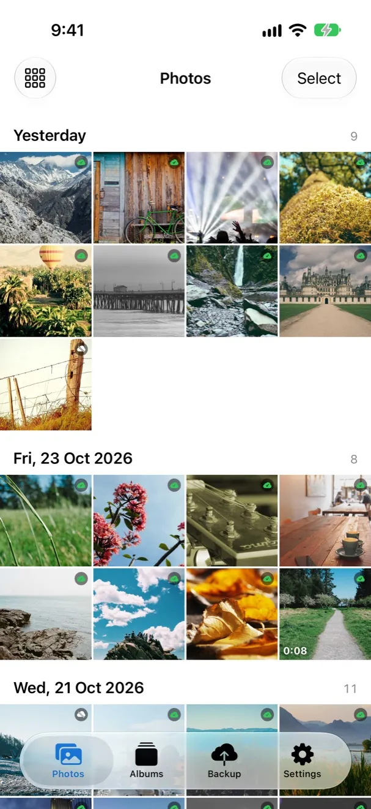
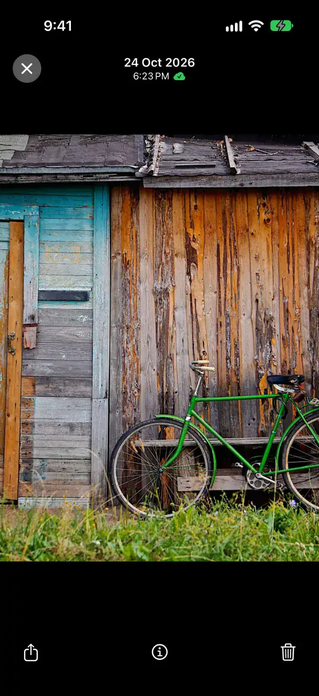
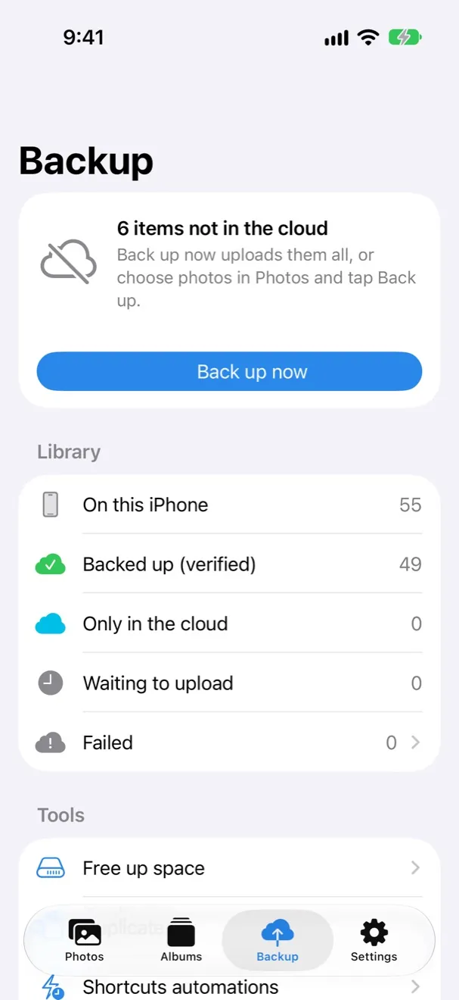

<h1 align="center">
  <a href="https://lelvo.app"></a><br>
  Lelvo
</h1>

<p align="center">
  <strong>Back up every photo and video, in original quality, to a private channel in your own Telegram account.<br>
  Browse it all in one fast timeline on iPhone, Mac and Android.</strong>
</p>

<p align="center">
  <a href="https://lelvo.app"><strong>Website</strong></a> ·
  <a href="#install"><strong>Install</strong></a> ·
  <a href="#what-it-does"><strong>Features</strong></a> ·
  <a href="docs/FAQ.md"><strong>FAQ</strong></a> ·
  <a href="https://t.me/lelvo_chat"><strong>Telegram</strong></a> ·
  <a href="#support"><strong>Sponsor</strong></a>
</p>

<p align="center">
  <a href="https://github.com/shahil-kv/Lelvo/releases/latest"><picture><source media="(prefers-color-scheme: dark)" srcset="https://shieldcn.dev/github/release/shahil-kv/Lelvo.svg?variant=ghost&amp;font=geist-mono&amp;mode=dark&amp;label=RELEASE&amp;logo=lu:Tag&amp;valueColor=A78BFA" /></picture></a>
  <a href="https://github.com/shahil-kv/Lelvo/releases"><picture><source media="(prefers-color-scheme: dark)" srcset="https://shieldcn.dev/github/downloads/shahil-kv/Lelvo.svg?variant=ghost&amp;font=geist-mono&amp;mode=dark&amp;label=DOWNLOADS&amp;logo=lu:CloudDownload&amp;valueColor=60A5FA" /></picture></a>
  <a href="https://github.com/shahil-kv/Lelvo/actions/workflows/ci.yml"><picture><source media="(prefers-color-scheme: dark)" srcset="https://shieldcn.dev/github/ci/shahil-kv/Lelvo.svg?variant=ghost&amp;font=geist-mono&amp;mode=dark&amp;workflow=ci.yml&amp;label=CI&amp;logo=lu:Hammer&amp;valueColor=4ADE80" /></picture></a>
  <a href="https://t.me/lelvo_chat"><picture><source media="(prefers-color-scheme: dark)" srcset="https://shieldcn.dev/badge/TELEGRAM-JOIN.svg?variant=ghost&amp;font=geist-mono&amp;mode=dark&amp;logo=telegram&amp;valueColor=38BDF8" /></picture></a>
  <br>
  <picture><source media="(prefers-color-scheme: dark)" srcset="https://shieldcn.dev/badge/IOS-17%2B.svg?variant=ghost&amp;font=geist-mono&amp;mode=dark&amp;logo=apple" /></picture>
  <picture><source media="(prefers-color-scheme: dark)" srcset="https://shieldcn.dev/badge/MACOS-15%2B.svg?variant=ghost&amp;font=geist-mono&amp;mode=dark&amp;logo=apple" /></picture>
  <picture><source media="(prefers-color-scheme: dark)" srcset="https://shieldcn.dev/badge/ANDROID-10%2B.svg?variant=ghost&amp;font=geist-mono&amp;mode=dark&amp;logo=android&amp;valueColor=4ADE80" /></picture>
  <a href="LICENSE"><picture><source media="(prefers-color-scheme: dark)" srcset="https://shieldcn.dev/badge/LICENSE-GPL--3.0.svg?variant=ghost&amp;font=geist-mono&amp;mode=dark&amp;logo=lu:Scale" /></picture></a>
</p>

<p align="center">
  
  
  
  
</p>

<!-- Mac screenshot: add docs/images/mac.png and uncomment.
<p align="center"></p>
-->

It's not about free storage. It's about ownership: your photos live in a private channel you own, inside a Telegram
account you already have, encrypted on your device before anything is uploaded. No Lelvo servers, no accounts of our
own, no analytics, no ads. Your photos go straight from your device to your Telegram library, and nowhere else.

> [!NOTE]
> Lelvo uses the Telegram API. It is an independent app, not made, endorsed or supported by Telegram.
> Your storage lives in your Telegram account and is subject to [Telegram's Terms of Service](https://telegram.org/tos).

## Contents

- [Why Lelvo exists](#why-lelvo-exists)
- [End-to-end encryption](#end-to-end-encryption)
- [What it does](#what-it-does)
- [Install](#install)
- [First launch](#first-launch)
- [Before you trust it with your only copy](#before-you-trust-it-with-your-only-copy)
- [What Lelvo doesn't do (yet)](#what-lelvo-doesnt-do-yet)
- [Questions people ask](#questions-people-ask)
- [Privacy](#privacy)
- [Contributing](#contributing)
- [Building from source](#building-from-source)
- [Support](#support)
- [License and credits](#license-and-credits)

## Why Lelvo exists

Every photo cloud makes the same deal: free at first, then a storage plan, and a company that can see your library.
iCloud gives you 5 GB, Google 15 GB shared with Gmail, and then it's a monthly bill for as long as you want your
memories back.

Telegram already gives every account cloud storage with no stated cap, and files of up to 2 GB each (4 GB with
Telegram Premium). Lelvo turns that into a real photo backup: your library goes to a **private channel that you own**,
inside **your own** Telegram account. There is no Lelvo server in between, no Lelvo account, and nothing for us to see.

| | Lelvo | iCloud Photos | Google Photos |
|---|---|---|---|
| **Free storage** | Your Telegram account's cloud, no stated cap | 5 GB | 15 GB, shared with Gmail and Drive |
| **After that** | Still free | Monthly plan | Monthly plan |
| **Originals kept bit for bit** | Yes | Yes | Yes (Original quality uses your storage) |
| **End-to-end encryption** | Always on | Only with Advanced Data Protection | No |
| **Who runs the servers** | Telegram, in your own account | Apple | Google |
| **Open source** | Yes, every line | No | No |
| **Leave any time** | Export everything, or decrypt with the [open format](docs/CLOUD_FORMAT.md) | Yes | Yes (Takeout) |

Nobody is asking you to trust Telegram blindly either. Lelvo gives you another choice: storage you already have,
encryption you control, and code you can read.

## End-to-end encryption


Telegram cloud chats are encrypted in transit and on Telegram's servers, not end-to-end — the same as Google Photos,
and iCloud unless you turn on Advanced Data Protection.

So **every Lelvo library is end-to-end encrypted**. When you open your library channel in the normal Telegram app,
every photo is an unreadable `.cge` file with a random name, and its caption (date, original file name, size) is
ciphertext. Both are encrypted on your device with AES-256-GCM in 1 MiB chunks (still streamable), using a key
derived from your passphrase (PBKDF2, 600,000 rounds), before anything leaves your device.

Telegram stores files it can't open. Neither can we. Open the same channel in Lelvo on any of your devices, enter
your passphrase (or recovery key), and it's your photo library again.

<br clear="right">

## What it does

- **Originals, untouched.** HEIC, ProRAW, RAW + JPEG, HEVC, ProRes, 4K/60, HDR and Dolby Vision are uploaded bit for
  bit, with EXIF, location, edits and Live Photo pairs intact.
- **Big files work.** Files up to 2 GB (4 GB with Telegram Premium) upload directly; anything larger is split into
  parts and joined again on download.
- **One timeline across your devices.** Photos on this device and everything in your Telegram library together by day,
  month or year, with pinch to resize, a date scrubber, Collections, Memories, albums, favorites, map and on-device
  search.
- **Fast from the cloud, originals kept.** Big photos get a small screen copy and videos get a 1080p *fast version*
  (about a tenth of the size), made on your device while backing up. Cloud videos start in under a second and seek
  instantly, even on mobile data. Tap the quality button (**1080p ⌄**) to switch to the original 4K at any time, or
  choose *Original Quality* in Settings. Saving or sharing always gives you the original file.
- **Automatic background backup.** New photos back up automatically on iPhone (short background runs, overnight, and
  an optional Camera Shortcut for under-a-minute backups), Mac (within a minute while Lelvo is open), and Android.
- **Import from Google Photos or Drive.** Walk through Google Takeout zips in **Backup → Tools** and upload photos
  and videos with their dates, places, albums and favorites preserved.
- **Restore by signing in.** Your Telegram library is the source of truth. On a new phone or after a reinstall, sign
  in and your library comes back: dates, places, albums, favorites and Live Photo pairs.
- **Never twice.** Items are matched by Photos identifier and SHA-256, so nothing is uploaded twice across reinstalls
  or devices. A Duplicates tool cleans up what's already doubled.
- **Nothing counts until it's verified.** An item is marked backed up only after Telegram confirms every part with the
  expected size. Failures keep their reason and a Retry button.
- **Free up space safely.** Only items verified in Telegram and unchanged since their backup are offered, and the
  system always asks you to confirm before anything is removed from the device.
- **Recently Deleted, synced.** Deleting an item from your backup keeps it in Recently Deleted for 30 days across your
  devices so you can recover it.
- **Keep a second copy.** Download your whole library to Files, an external drive or a Mac folder at any time. On Mac,
  pick a folder on an external drive or NAS once and Lelvo keeps an up-to-date copy in `Year/Month` folders.
- **Native on every platform.** SwiftUI + UIKit on iPhone (with Shortcuts), SwiftUI + AppKit on Mac (Photos-style
  sidebar, menu bar status, keyboard shortcuts, drag to Finder), and Jetpack Compose on Android.

## Install

| Platform | How | Requirements |
|---|---|---|
| **Mac** | Download `Lelvo.dmg` from [Releases](https://github.com/shahil-kv/Lelvo/releases/latest), open it and drag Lelvo to Applications | macOS 15 or later (Apple silicon or Intel). Signed and notarized by Apple. |
| **Android** | Download the `.apk` from [Releases](https://github.com/shahil-kv/Lelvo/releases/latest) and open it to install | Android 10 or later (arm64). |
| **iPhone / iPad** | Download `Lelvo.ipa` from [Releases](https://github.com/shahil-kv/Lelvo/releases/latest) and install with [SideStore](https://sidestore.io), [AltStore](https://altstore.io) or [Sideloadly](https://sideloadly.io) | iOS 17 or later (runs on iPad in iPhone mode). App Store release in preparation. |

<details>
<summary><b>Sideloading on iPhone, step by step</b></summary>

1. Download `Lelvo.ipa` from the [latest release](https://github.com/shahil-kv/Lelvo/releases/latest). It's unsigned;
   your sideloading tool signs it with your Apple ID.
2. **SideStore**: My Apps → **+** → pick the IPA. SideStore refreshes it on the device every few days.
   **AltStore**: My Apps → **+**; AltServer on your computer refreshes it over Wi-Fi.
   **Sideloadly**: drag the IPA in, enter your Apple ID, Start.
3. First launch: **Settings → General → VPN & Device Management** → trust your Apple ID, and turn on
   **Settings → Privacy & Security → Developer Mode** if iOS asks.

Apps signed with a free Apple ID stop opening after **7 days** unless refreshed. SideStore and AltStore do that for
you. If it expires, install the IPA again over the old one: your sign-in and data stay. Even after a full reinstall,
signing in brings your library back from Telegram.
</details>

<details>
<summary><b>Opening a self-built Mac app the first time</b></summary>

Releases from 0.3.0 on are signed and notarized by Apple, so Lelvo opens like any other app. Builds you make from
source are not: macOS says it "can't check the app for malicious software". Click **Done**, open **System Settings →
Privacy & Security**, scroll down and click **Open Anyway** next to Lelvo, then **Open**. You only do this once.
</details>

<details>
<summary><b>Installing the APK on Android</b></summary>

1. Download `Lelvo-<version>.apk` from the [latest release](https://github.com/shahil-kv/Lelvo/releases/latest) on
   your phone.
2. Open the downloaded file. If Android asks, allow your browser or Files app to install unknown apps.
3. Follow the prompt to install. Future updates install right over the existing app without losing your sign-in.
</details>

## First launch

1. **Continue with Telegram** and enter the phone number of your Telegram account.
2. Enter the login code Telegram sends to your other Telegram apps (or by SMS), and your two-step password if you
   use one.
3. **Your library.** New here? Create a library, choose its passphrase (saved in Passwords on iPhone if you like) and
   store the recovery key somewhere safe. Coming back? Lelvo finds your existing library and restores it.
4. Allow **Full Access** to Photos, then tap **Backup → Back up now**. For a big first backup, keep the app open on
   Wi-Fi and power. On iOS 26 and later it keeps going in the background with progress on the Lock Screen.

Builds made from source without app keys ask for a free `api_id` / `api_hash` first: see
[docs/DEVELOPMENT.md](docs/DEVELOPMENT.md#telegram-app-keys).

## Before you trust it with your only copy

Lelvo is careful, but your backup lives in a Telegram account that Telegram controls. Read these once:

1. **Telegram deletes inactive accounts**, and your channel goes with them. The default is 18 months without opening
   any Telegram app. Lelvo shows the current setting and can change it to the maximum, 2 years (**Settings →
   Telegram**). Open the Telegram app now and then.
2. **Deleting the channel deletes the backup.** Your library is an ordinary private channel in your Telegram. Deleting
   it removes every file in it, and a deleted channel can't be restored. Don't rename it to something you might clean
   up later, and don't delete messages in it by hand.
3. **A frozen or banned account can't upload.** Accounts restricted after reports from other users can still read but
   can't post, so backups stop until it's resolved in the Telegram app. Normal personal use doesn't cause this.
4. **Lost passphrase and recovery key, lost photos.** Nobody, including us, can recover them. Keep your passphrase in
   a password manager and store your recovery key somewhere safe.
5. **Keep a second copy of what you can't lose.** That's good advice for any single service, including this one.
   **Settings → Download a copy of your library** (or **Keep a second copy** on Mac) makes that easy.

The details, with links to Telegram's own pages, are in **[docs/FAQ.md](docs/FAQ.md)**.

## What Lelvo doesn't do (yet)

Being honest about the gaps matters as much as the features:

- **No shared albums, links or family libraries.** It's a private backup of your own photos.
- **No face, object or text search.** Search works on places, dates, albums and media types on your device; nothing
  analyses your photo pixels, on a server or otherwise.
- **iPhone, Mac and Android only.** No Windows, Linux or web version is planned. The storage format is documented in
  [docs/CLOUD_FORMAT.md](docs/CLOUD_FORMAT.md) so anyone can build compatible tools.
- **Big first backups on iPhone need the app open** (or iOS 26's background continuation). iOS only gives apps short,
  system-controlled windows in the background.
- **Cloud speed is Telegram's.** Telegram sends free accounts roughly 1 MB/s, so saving a 4K original to Photos takes
  about a minute per 60 MB, and playing a 4K original (instead of its fast version) can stop to load. Each fast
  version adds about 10% to the space a video takes in your Telegram library.
- **Telegram's rules apply to your storage.** If Telegram changes its limits or terms, Lelvo can't override them.

## Questions people ask

<details><summary><b>Is this allowed by Telegram?</b></summary>

Yes. Telegram's API is open to third-party apps under the [Telegram API Terms of Service](https://core.telegram.org/api/terms).
Lelvo uses its own `api_id`, says on its welcome screen that it uses the Telegram API, doesn't use "Telegram" in its
name or Telegram's logo, and doesn't change how Telegram works for anyone else.
</details>

<details><summary><b>Is Telegram storage really unlimited?</b></summary>

Telegram describes its cloud storage as unlimited, with files up to 2 GB each (4 GB with Premium); see
[Telegram's Terms of Service](https://telegram.org/tos) and the [Telegram FAQ](https://telegram.org/faq). That's
Telegram's promise, not ours, and it can change. Lelvo splits bigger files automatically.
</details>

<details><summary><b>Can Telegram see my photos?</b></summary>

No. Every library is end-to-end encrypted: files and captions are encrypted on your device before upload, and Telegram
only stores unreadable `.cge` files. Telegram cloud chats on their own aren't end-to-end encrypted
([Telegram FAQ](https://telegram.org/faq#q-so-how-do-you-encrypt-data)), which is why Lelvo locks every file first.
</details>

<details><summary><b>What if I delete the channel by mistake, or my account is deleted or frozen?</b></summary>

See [docs/FAQ.md → When something goes wrong in Telegram](docs/FAQ.md#when-something-goes-wrong-in-telegram). Short
version: a deleted channel or account can't be brought back; a frozen account can still be read and can appeal in the
Telegram app; photos still on your phone are never deleted by any of this.
</details>

<details><summary><b>Will it fill up my phone?</b></summary>

No. Thumbnails and viewed items are cached with hard limits (300 MB and 1 GB by default) and can be cleared in
**Settings → Storage**. Viewing cloud items never keeps them permanently.
</details>

<details><summary><b>How do cloud videos play so fast if the originals are huge?</b></summary>

Like iCloud Photos and Google Photos, Lelvo plays a smaller version and keeps the original untouched. Because Lelvo
has no servers, your device makes that version itself while backing up: 1080p HEVC at about 2 Mbit/s, audio copied as
it is, about a tenth of the size of a 4K original. Telegram delivers it about four times faster than it plays, so it
starts at once and seeks smoothly. Tap **1080p ⌄** in the viewer to switch to the 4K original, or set **Settings →
Backup options → Play cloud videos → Original Quality**.
</details>

<details><summary><b>Windows? Linux? Web?</b></summary>

Not planned. The project focuses on making the iPhone, Mac and Android apps excellent. See
[docs/not-planned.md](docs/not-planned.md).
</details>

More in **[docs/FAQ.md](docs/FAQ.md)**. Still stuck? Ask in the [Telegram group](https://t.me/lelvo_chat),
[GitHub Discussions](https://github.com/shahil-kv/Lelvo/discussions) or see **[SUPPORT.md](SUPPORT.md)**.

## Privacy

Lelvo has no servers and we never receive your data: no analytics, no crash reporting, no tracking. Your phone number
and login code go only to Telegram. Your Telegram session, app keys and encryption key stay in your device's Keychain
or Keystore. Logs stay on the device unless you choose to share them, and phone numbers, keys and IDs are removed from
them first. Full policy: **[PRIVACY.md](PRIVACY.md)**.

## Contributing

Bug reports, ideas, translations and code are welcome. Please read **[CONTRIBUTING.md](CONTRIBUTING.md)** first:

- **Bugs and ideas** start as [issues](https://github.com/shahil-kv/Lelvo/issues/new/choose), using the forms.
- **Code**: wait for the issue to be labelled `approved`, then open a pull request that says `Closes #<number>`.
  Pull requests without an approved issue are closed automatically. Docs-only changes don't need approval.
- Every pull request needs the one-time [Contributor License Agreement](CLA.md) (a bot asks you on your first PR).
- Be kind: [Code of Conduct](CODE_OF_CONDUCT.md). Security problems: [SECURITY.md](SECURITY.md), never a public issue.

## Building from source

**Apple (iPhone and Mac):** Xcode 26 or later and [XcodeGen](https://github.com/yonaskolb/XcodeGen).

```sh
brew install xcodegen
git clone https://github.com/shahil-kv/Lelvo.git && cd Lelvo
xcodegen generate && open Lelvo.xcodeproj
```

**Android:** Android Studio / JDK 17. Put your `sdk.dir` (and optional `telegram.apiId` / `telegram.apiHash`) in
`android/local.properties`, then:

```sh
cd android && ./gradlew :core:test :app:assembleDebug
```

```text
iOS/                   iPhone and iPad app
macOS/                 Mac app
Shared/                services and screens shared by iOS and macOS (Telegram, backup, onboarding, settings)
Packages/LelvoCore/    storage format, encryption, index and upload queue (Swift, with unit tests)
android/               Android app (Kotlin, Jetpack Compose, shared format and test vectors)
UITests/               iOS UI tests
MacUITests/            Mac UI tests
Config/                Apple build settings; Telegram app keys go in Config/Secrets.xcconfig (never committed)
docs/                  FAQ, architecture, storage format, changelog, development and release guides
```

Everything else (app keys, tests, the device workflow, releasing) is in
**[docs/DEVELOPMENT.md](docs/DEVELOPMENT.md)** and **[docs/CHANGELOG.md](docs/CHANGELOG.md)**.

## Support

Lelvo is free and open source, and every feature stays free. Your storage is your own Telegram account's, so there is
no storage plan to buy. Keeping the apps built, notarized and maintained still has real costs (the Apple Developer
membership, test devices, domain and time). If Lelvo saves you a monthly storage bill, consider sponsoring its
development.

<p align="center">
  <a href="https://lelvo.app/support"><picture><source media="(prefers-color-scheme: dark)" srcset="https://shieldcn.dev/badge/SUPPORT-CARD%20%2F%20UPI.svg?variant=outline&amp;size=lg&amp;font=geist-mono&amp;mode=dark&amp;logo=lu:Heart&amp;logoColor=A78BFA&amp;valueColor=A78BFA" /></picture></a>
</p>

## License and credits

Lelvo is free software under the **[GNU General Public License v3.0](LICENSE)**: you may use, study, share and change
it, and copies you distribute must stay under the same license with their source code. Contributions are accepted
under the [Contributor License Agreement](CLA.md). The Lelvo name and icon are covered by
[TRADEMARKS.md](TRADEMARKS.md). Third-party licenses: [NOTICE.md](NOTICE.md).
