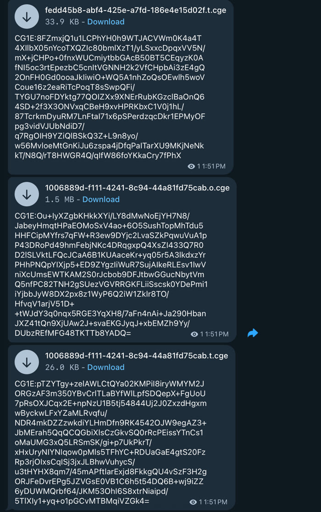

# Features

What Lelvo does, how it keeps your photos private, and what it doesn't do. To install it, see
[INSTALL.md](INSTALL.md). For questions, see the [FAQ](FAQ.md).

- [Why Lelvo](#why-lelvo)
- [Everything it does](#everything-it-does)
- [How it works](#how-it-works)
- [Privacy](#privacy)
- [Limitations](#limitations)

## Why Lelvo

Every photo cloud makes the same deal: free at first, then a monthly plan, run by a company that can see your library.
Telegram already gives every account cloud storage with no stated cap. Lelvo turns it into a real photo backup that you
own: a private channel in your own Telegram account, locked with a passphrase only you know.

No Lelvo servers, no Lelvo account, no analytics and no ads. Your photos go from your device to your Telegram library
and nowhere else.

| | Lelvo | iCloud Photos | Google Photos |
|---|---|---|---|
| **Free storage** | Your Telegram account's cloud, no stated cap | 5 GB | 15 GB, shared with Gmail and Drive |
| **After that** | Still free | Monthly plan | Monthly plan |
| **Original files, bit for bit** | Yes | Yes | Yes (Original quality uses your storage) |
| **End-to-end encryption** | Always on | Only with Advanced Data Protection | No |
| **Open source** | Yes, every line | No | No |
| **Leave any time** | Export everything, or decrypt with the [open format](CLOUD_FORMAT.md) | Yes | Yes (Takeout) |

> [!NOTE]
> Lelvo uses the Telegram API. It is an independent app, not made, endorsed or supported by Telegram.
> Your storage lives in your Telegram account and follows [Telegram's Terms of Service](https://telegram.org/tos).

## Everything it does

- **Original files.** HEIC, ProRAW, RAW + JPEG, HEVC, ProRes, 4K, HDR and Dolby Vision are uploaded bit for bit, with
  EXIF, location, edits and Live Photos intact.
- **End-to-end encrypted.** Every file and its details are locked on your device before upload. Telegram only ever
  stores files it can't open.
- **One timeline.** Photos on your device and in your Telegram library together, by day, month or year, with
  Collections, Memories, albums, favorites, a map and on-device search.
- **Fast from the cloud.** Videos get a small 1080p copy made on your device, so they start in under a second. Switch
  to the 4K original at any time. Saving or sharing always gives you the original file.
- **Automatic backup.** New photos back up in the background on iPhone, Mac and Android.
- **Restore by signing in.** On a new phone, sign in and your library comes back: dates, places, albums, favorites and
  Live Photos.
- **Never twice.** Items are matched by fingerprint, so nothing uploads twice across reinstalls or devices.
- **Verified before it counts.** An item is backed up only after Telegram confirms every part with the expected size.
- **Free up space safely.** Only items checked complete in Telegram are offered, and the system asks you to confirm
  before anything leaves your device.
- **Big files work.** Up to 2 GB per file (4 GB with Telegram Premium). Larger files are split and joined for you.
- **Recently Deleted.** Items you delete from your backup stay recoverable for 30 days on all your devices.
- **Import from Google Photos.** Bring in Google Takeout zips with dates, places, albums and favorites.
- **Keep a second copy.** Download your whole library to Files, a drive or a Mac folder, and keep it up to date.
- **Native on every platform.** SwiftUI on iPhone and Mac, Jetpack Compose on Android.

## How it works

1. You sign in with your own Telegram account. Lelvo creates a private channel there: your library.
2. Each photo is encrypted on your device with AES-256-GCM, using a key made from your passphrase (PBKDF2,
   600,000 rounds). Its date, name and size are encrypted too.
3. Lelvo uploads it to your channel, at most two files at a time, and waits whenever Telegram asks it to slow down.
4. Any of your devices can open the library with your passphrase or recovery key.

Open the channel in the normal Telegram app and you only see unreadable `.cge` files. Telegram can't open them, and
neither can we. The channel is the source of truth, and its [storage format](CLOUD_FORMAT.md) is public, so your
photos stay yours even without Lelvo. More in [ARCHITECTURE.md](ARCHITECTURE.md).

 

## Privacy

Lelvo has no servers and never receives your data: no analytics, crash reporting or tracking. Your phone number and
login code go only to Telegram. Your session and encryption key stay in your device's Keychain or Keystore. Logs stay
on your device unless you share them, with phone numbers, keys and IDs removed first.
Full policy: **[PRIVACY.md](../PRIVACY.md)**.

## Limitations

- No shared albums, links or family libraries. It's a private backup of your own photos.
- No face or object search. Nothing analyses your photos, on a server or otherwise.
- No Windows, Linux or web app is planned ([why](not-planned.md)). The [open format](CLOUD_FORMAT.md) lets
  anyone build compatible tools.
- On iPhone, a big first backup needs the app open, or iOS 26's background continuation.
- Cloud speed is Telegram's. Free accounts get about 1 MB/s, so a 4K original takes a while to save.
- Telegram's limits and terms apply to your storage, and Lelvo can't change them.
